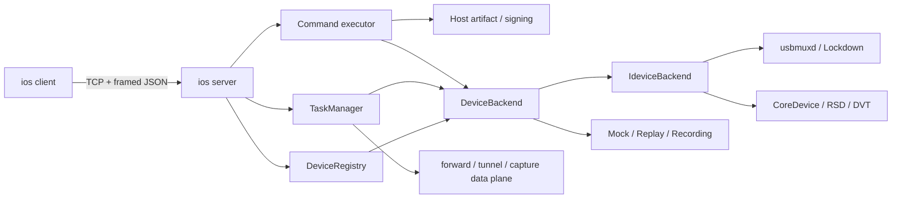

# 架构设计

## 设计目标

`rust-ios` 保留 go-ios 的设备能力和主要 CLI 入口，但改变宿主机资源生命周期：设备发现、
forward listener、CoreDevice tunnel、日志和抓包都属于一个本机 server。client 只提交请求、
读取结果或短期附着数据流，不能生成独立长期子进程。



## Workspace 边界

依赖方向为 `cli -> server -> core -> protocol`：

| crate | 职责 | 禁止事项 |
|---|---|---|
| `rust-ios-protocol` | wire model、frame codec、稳定错误码 | 依赖 workspace 其他 crate 或设备库 |
| `rust-ios-core` | Apple service、backend trait、数据面 bridge | 暴露 `idevice` 类型到 IPC/CLI |
| `rust-ios-server` | 生命周期、认证、registry、task supervisor、state | 让普通命令生成长期子进程 |
| `rust-ios-cli` | 参数、自动启动、输出和本地 help | 直接调用 `idevice` |

真实、mock、replay 和 recording 均实现同一个 `DeviceBackend`。forward 使用 `BoxedIo`，tunnel
使用 `UserSpaceTunnel`，日志/抓包使用 `DeviceStream`，DVT condition 使用 `DeviceCondition`；
server 不需要知道底层 Apple service 类型。

`TaskManager::execute` 先调用 core 的 host command router，再决定是否进入 `DeviceBackend`。
`ui download`、App Store Connect signing asset 和不带 `--install` 的 `sign app` 因而不刷新或选择设备；`ui install` 与
`sign app --install` 只把最终 installation_proxy 步骤留给真实 backend。artifact 下载、CMS
mobileprovision/P12 解析、`.app/.ipa` 重签名均在 core，CLI 不接触 `idevice`。

## Server 生命周期

普通命令调用 `ensure_server`：

1. 从 home 读取或创建 256-bit `auth.token`。
2. 尝试连接配置地址并完成 protocol hello。
3. 仅在 connection refused/reset/timeout 时启动当前 executable 的 `server nodaemon`。
4. 等待 child 就绪；认证失败和 protocol mismatch 不会触发第二个 server。
5. server 取得 `server.lock` 独占锁、bind 后原子写入 `server.json`。

Windows 使用原生 `CreateProcessW`，设置 `CREATE_NO_WINDOW | DETACHED_PROCESS` 且
`bInheritHandles=FALSE`。这样 server 不继承 PowerShell、Node 或 CI 的 stdout pipe；server 自行把
日志写入 `server.log`。macOS/Linux 的 spawn 边界位于 `platform` 模块。

`server.json` 记录 PID、instance UUID、executable、地址、版本和 protocol 版本。它只是发现
元数据，不是锁；进程强杀后的陈旧文件会在下一次自动启动时被新实例替换。

## Device Registry

server 每秒刷新一次 backend device snapshot，显式 UDID 优先，默认选择 USB，其次 network。
`list` 主动刷新；`listen` 使用 registry watch channel 和 2 秒超时长轮询，不为每个 client 创建
设备监听进程。断开的等待请求最多保留到超时。

Windows 默认使用 Apple Mobile Device Process 的 `127.0.0.1:27015`；
`USBMUXD_SOCKET_ADDRESS` 可覆盖。Unix 平台由 `idevice::UsbmuxdAddr` 选择 Unix socket。

## 持久任务

`TaskRecord` 持久化的是 desired state，不持久化 socket、密钥、join handle 或设备 client：

```text
id, kind, desired_state, runtime_state, restart_policy
generation, attempts, timestamps, message, spec, runtime
```

`state-v1.json` 通过同目录临时文件加原子替换写入。损坏 JSON 会移动为带时间戳的
`state-v1.corrupt-*`，server 从空 desired state 启动。恢复时 generation 增加，运行时对象按 spec
重建。

状态含义：

- `starting`：创建 listener/service/文件。
- `waiting`：设备、usbmuxd 或目标进程暂不可用。
- `running`：数据面已建立。
- `backing_off`：可重试错误，250 ms 到 5 s 指数退避。
- `failed`：参数、权限、平台或未实现错误，不再自动重试。
- `stopped`：client 或 server shutdown 已取消运行对象。
- `completed`：有限任务已正常执行到协议终点；测试断言失败记录在 runtime `outcome=failed`，不混同
  transport/runner failure。

`task stop` 会从 desired state 移除任务，但保留 capture 文件。`task restart` 先取消并等待旧 runner，
再提高 generation 并启动一个新 runner；同一 managed task 不会并行保留两个 runner。

`webinspector_js_shell` 是 server-owned 交互 task。持久 spec 只记录选择器、page 启动参数、timeout 和
capture path；mpsc input sender、InspectorSession 与待回复 oneshot 只属于当前 runtime。每条 expression
串行完成并写 NDJSON 后回复 client。其 restart policy 为 `never`，所以 server interruption 不会重放
可能有副作用的 JavaScript；用户只能显式 restart 建立新 session。

`accessibility_inspector` 是 server-owned Lockdown AX DTX stream。spec 只持久化 UDID、capture path 和可选
font size；socket/AX client 只属于当前 runner。同设备只允许一个 task。启动按 go-ios 顺序切换到 device
并开启 selection mode，event 追加为 NDJSON；close 在 server 的 3 秒 stop budget 内关闭 monitored event、
selection visuals 和 app monitoring。

`ui_stream` 是 host HTTP 持续任务，不进入设备 backend：CLI 把 WDA/DeviceKit URL、format/query 和
client-resolved output path 写入 spec，server 持有 response body 并追加 capture。auto driver 在每次
重连时重新探测；若 URL 属于本 server 的 WDA task，spec 同时持有其 task ID，每次重连从 WDA 最新
runtime 取动态 URL。stop 会 drop response，server restart 以同一 task ID 重新连接。其中 HTTP API
使用 `wdaUrl`，MJPEG 使用 device port 9100 对应的独立 `mjpegUrl` 根路径。binary stream
仍通过 `task output` 读取，普通 `ui` 命令不会持有长期子进程或 socket。

XCTest、AppProcess 和 GPX LocationSimulation 使用 `restartPolicy=never`。正常完成或 failure 后
record/output 保留，server
重启不会自动重跑；若 server 在执行中断电/强杀，恢复时标为 `failed`。只有显式 `task restart` 会
创建下一代，确保有限任务默认是 at-most-once，而不是常驻 task 的 desired-state 自动恢复语义。

## 数据面

### Forward

server 先 bind host port，再持久化任务并返回。每个入站连接实时解析目标设备，通过 usbmuxd
连接 device port，然后使用双向异步 copy。默认 bind `127.0.0.1`；显式 `--bind 0.0.0.0` 才暴露
到局域网。

### Userspace 与 Windows Kernel Tunnel

真实 backend 通过 `CoreDeviceProxy -> CDTunnel -> jktcp Adapter` 建立软件 TCP stack。兼容 endpoint
接受 go-ios 数据面握手：16-byte IPv6 address 加 4-byte little-endian port，随后透明 bridge。
Windows kernel backend 通过 `tun-rs` 动态加载显式绝对路径的 `wintun.dll`，分配 CDTunnel client
IPv6 `/64` 与 negotiated MTU，再并发执行 Wintun -> CDTunnel 和 CDTunnel -> Wintun raw IPv6 数据泵。
runner、adapter、transport 和 route handle 都由 tunnel supervisor 持有；取消、失败、server shutdown
和 restart 都先移除 registry handle，再关闭数据泵与 adapter。kernel mode 不 bind userspace endpoint。

tunnel runner 将实际 UDID 与 live `UserSpaceTunnel` 注册到 server 内存 registry；RSD handshake 和
service map 由 core 在 tunnel 内缓存。`rsd ls` 与 debug proxy 只借用该 live handle，不会创建第二条
CoreDevice tunnel。tunnel stop/retry 会原子移除旧 handle，依赖 task 进入 waiting 并重新绑定。

`info display` 通过同一 handle 打开 `com.apple.coredevice.deviceinfo`，完成 XPC handshake 后调用
`getdisplayinfo` feature；`info lockdown` 不进入 tunnel。`ps/launch/kill/memlimitoff/devicestate` 与
notifications/sysmontap/screenshot DVT stream 由 task
manager 按 UDID 注入同一 live handle。core 使用
`connect_rsd_service(com.apple.instruments.dtservicehub)` 创建 DVT client；iOS 17+ 没有 active tunnel
时返回 `device_unavailable`，不再回退旧 Lockdown Instruments。旧系统仍保留 Lockdown transport。
task runtime 的 `serviceTransport` 明确为 `shared_rsd` 或 `lockdown`。恢复时 tunnel task 先启动，
再恢复依赖 task，避免启动竞态创建错误 transport。

`launch --wait` 始终要求 active userspace tunnel。core 先打开
`com.apple.coredevice.openstdiosocket` 并读取 UUID，再用 `com.apple.coredevice.appservice` 启动
app，将合并 stdout/stderr 交给 server capture。OpenStdio EOF 表示有限任务完成；task stop 或
server shutdown 会查询 PID 是否仍存在，仅向本 session 启动的 PID 发送终止信号。

sysmontap 通过公开 DVT channel 先读取 DeviceInfo attributes，发送与 go-ios 一致的 config，并递归
解包设备返回的嵌套 sample batch；不能把“channel 已打开”当作已经收到监控数据。

### Debug Proxy

普通 `DebugProxySpec` 持久化 loopback listener。每个 GDB remote client 通过 registry 打开
`com.apple.internal.dt.remote.debugproxy` 并透明 bridge；service 连接失败会清除 RSD cache 并让
supervisor 进入 waiting/backoff。server shutdown、task stop 和 tunnel 消失都会终止数据面。

`debug <app_path>` 使用同一 supervisor，但将 spec 标为 `client_owned`。这类 task 不写入
`state-v1.json`，owner IPC 连接持有 lease；连接 EOF/reset/error 时 server 按 task id 停止它。
CLI 在正常 LLDB 退出、spawn/exit 失败和 Ctrl+C 路径仍显式 `TaskStop`，断连清理是强制终止时的
兜底。core 只解析本地/设备 app 路径；listener 和 device session 仍完全归 server/task manager。

### Dproxy

`DproxySpec` 持久化显式 bind endpoint、数值 IP upstream、capture mode 和绝对 master NDJSON path。
Windows supervisor 先 bind listener 并把动态 port 写回 state，再接受多个并发 connection；每条连接
由 core 建立独立 upstream socket并执行双向透明 pump。client write EOF 只 half-close upstream write，
不会取消仍在返回数据的方向；task 取消或方向错误才启动有界收尾。supervisor join 超时时会显式 abort，
禁止 detached runtime 脱离 task manager。

master NDJSON 记录 connection lifecycle 与 aggregate counters；每条连接按 generation/sequence 分目录
写两个 raw dump。非 binary 模式还解析初始 usbmuxd frame/plist，在匹配 `Connect` tag 的成功 `Result`
后原子切换两个方向到 raw mode，避免把 device service payload 误判为 usbmuxd。parsed plist 对 PairRecord、
private key、password、escrow 等字段递归脱敏；raw dump 不做也无法保证脱敏。

Windows 不替换 Apple `127.0.0.1:27015`，只有显式连接 runtime `endpoint` 的 client 被捕获。listener
必须解析为 loopback，避免把 usbmuxd 设备访问暴露给网络；listener 与同 port upstream 地址重叠也
会拒绝，避免 self-proxy loop。`utun` variant 保留在
protocol 中但返回 `not_implemented`；系统级 socket interception 和 DTX decode 不属于当前实现。

### XCTest/WDA

`WdaSpec` 持久化 runner/target bundle、args/env、readiness timeout 与 NDJSON output path。core 使用 `idevice` 的
XCTest orchestration 启动 xctrunner，轮询 WDA `/status` 后创建动态 localhost HTTP/MJPEG bridge；
同一个 XCTest listener 将 callback 写入 session-owned channel，server 在 health loop 中非阻塞 drain、
flush 并更新 `eventsWritten/bytesWritten`。首次 task start 截断 capture，内部重试和 server restore
追加；`task output` 统一读取。task stop 或优雅关闭会 abort runner、释放 bridge。

受控 `idevice 0.1.65` fork 提供对象安全的 `XCTestRsdProvider` injection。server supervisor 从同设备
active tunnel registry 取出 `Arc<dyn UserSpaceTunnel>`，依次交给 WDA、UI runner 和 finite XCTest；
real backend 通过 tunnel 的 RSD service registry 按名字查找
`com.apple.instruments.dtservicehub` 与 `com.apple.dt.testmanagerd.remote`，做 checked `u32 -> u16`
转换后打开三个 DTX socket。此路径 runtime 标为 `shared_rsd`，transport 日志明确记录
`reusing caller-owned shared RSD connector`。没有 active tunnel 时仍保留 task-owned dedicated
CoreDevice/RSD fallback 并标为 `dedicated_core_device`；两条路径都没有长期子进程。

workspace 同一受控 fork 还修正 unit host launch 和 test filter archive：unit host 注入
`libXCTestBundleInject.dylib` 且不使用 UI activate options，configuration 同时写 legacy `NSSet` 和
modern `XCTTestIdentifierSet`。shared provider 只负责 named socket；tunnel discovery、route 生命周期和
registry refresh 始终由 server/task manager 所有。

### Stream/Capture

syslog、ostrace 和 pcap 使用 `DeviceStream`：core 产出 opaque chunk 和 content type，server 负责
打开文件、flush、统计和重试。PCAP 文件首次创建时写一个 global header；server 重启只追加
records，不重复 header。默认文件位于 `<home>/captures`。

ostrace 的 typed level/subsystem/message options 存在 task spec 中；real backend 在 `OsTraceLog` 解析后
组合过滤，再生成 raw/JSONL chunk。当前上游 `idevice` API 固定启动全量 trace，不能把 host-side output
filter 描述为 device-side 流量优化。

`task output` 只读取该任务 spec 中的文件，包括 stream、dproxy、WDA、UI runner、XCTest 和 app process；
单次最多 1 MiB，以 base64 通过 IPC 返回；`--raw`
在 client 解码。offset/nextOffset 可用于增量读取。

### DVT Device Condition

`devicestate list` 通过一次性 `ConditionInducerClient` 返回 condition/profile；`enable` 则创建
`DeviceStateSpec`。core 在启用前验证 condition/profile，server 持有底层 DVT remote。task 取消
和 server 优雅关闭都会调用 `disable_condition`；server 重启依据 desired state 重新建立 session。

### MCInstall 与 Supervision

MCInstall 仍是一次性 command，不创建持续 task。`McInstallClient` 封装 4-byte big-endian plist frame、
16 MiB 上限、ack 校验、profile/cloud config 和 escalation sequence。Wi-Fi/proxy profile 使用 plist
结构构造，不拼接 XML，因此 SSID、password、host、username 中的 XML 字符不能注入 payload。

supervision identity 只在 `rust-ios-core::supervision` 解析：PKCS#12 解密得到 RSA private key 和 leaf
certificate；server 将 certificate 发送给 `Escalate`，用 private key 在内存中对 challenge 生成 CMS
SignedData，再发送 `EscalateResponse`。private key/P12 不进入 protocol model、desired state 或 recording。
实现为纯 Rust，不要求 Windows OpenSSL DLL，也保持 macOS/Linux 构建边界一致。

`prepare create-cert` 是 host-only execute 分支，在选择设备之前运行，但输出路径仍按 client cwd 解析。
完整 `prepare` 才连接 activation、MCInstall、Lockdown 和 AFC；它是高风险写操作，不进入默认 smoke。

UI artifact/signing 使用同一 host 边界：下载先写随机 `.part` 再 rename，ZIP entry 通过 enclosed path
校验；重签名校验 profile 到期时间、DeveloperCertificates、ProvisionedDevices 和
`application-identifier`。P12 用 `p12-keystore` 解包后把 leaf certificate/PKCS#8 或 PKCS#1 key
交给 `apple-codesign`，避开平台 `codesign` 子进程并保持 Windows/Linux 可运行。

App Store Connect 同样不进入 `DeviceBackend`：core 读取 client-relative `.p8`，生成短期 ES256 JWT，
通过 JSON:API ensure Bundle ID/device 并创建 RSA CSR/certificate/P12/profile。`provision` 使用 IPC 中的
显式 UDID 字符串，不要求连接真机。P12/profile 原子替换；private key、JWT/password 不进入 result、
task state 或 recording。HTTP override 仅允许 HTTPS 或 loopback，避免把 bearer token 发往普通明文 host。

## 安全与故障边界

- 只接受 loopback peer，并仍要求 token；token 使用常量时间比较。
- 帧上限 16 MiB，在分配 payload 前校验长度。
- 每个 response 必须匹配 UUID request ID。
- 默认 forward 不公开监听；任意输出路径必须由 client 解析为绝对路径。
- PairRecord 可由用户显式读取，但 recording backend 永远只记录 `redacted: true`。
- recording 对 profile/Wi-Fi/proxy/P12 password 和 launch env value 做 argv 脱敏。
- dproxy parsed plist 会脱敏已知 pairing/private-key 字段，但双向 raw dump 视为未脱敏敏感材料。
- 未迁移命令/flag 返回稳定 `not_implemented`，不会降级到相似但语义不同的操作。
- server shutdown 取消全部 runtime，但保留 desired state，所以下次启动可恢复；client 的
  `task stop` 才会删除 desired state。

## 跨平台状态

IPC、codec、state、task、mock/replay、userspace bridge 均为跨平台 Rust。Windows 已完成进程级
验证；macOS/Linux 尚需验证后台 spawn、文件替换、Unix usbmuxd socket 和真实 CoreDevice。
Windows Wintun backend 已进入 core 的 Windows-only implementation，protocol 只携带 mode、adapter name
和 DLL path；Linux TUN 与 macOS utun 仍需各自实现。dproxy core pump/decoder 跨平台，但当前 server
只实现 TCP upstream；Unix socket replacement/forwarding 尚未实现。设备协议不得进入 CLI/protocol crate。
